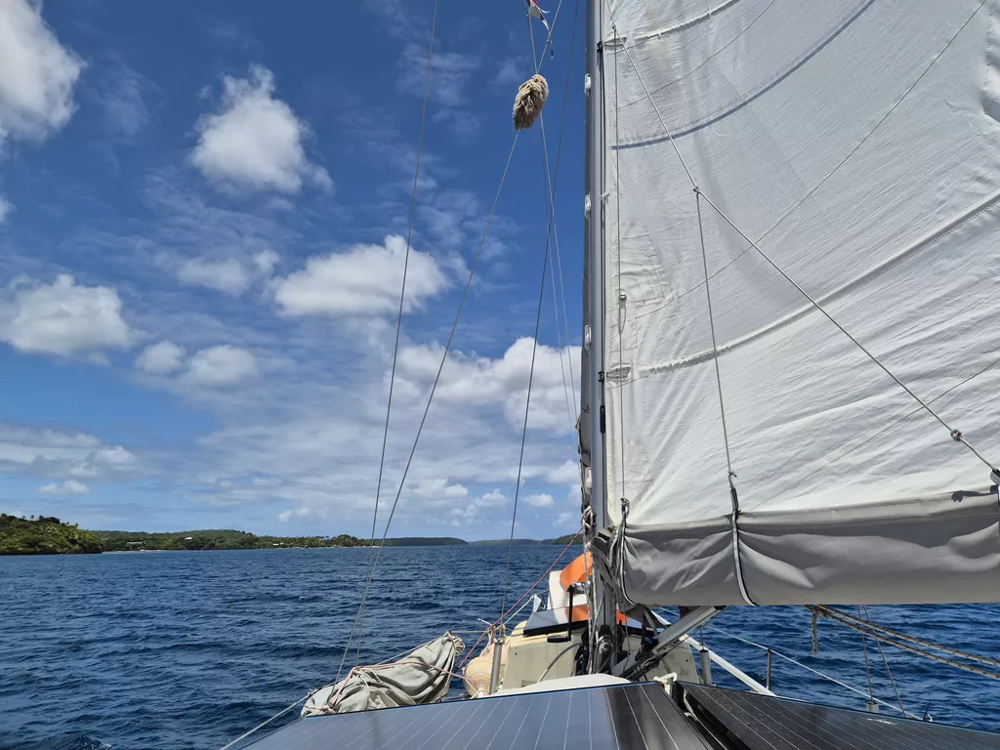

After over a month in Neiafu, we heard the seiren song of the open ocean once more. We checked out of Tonga and raised the main sail in 1st reef and gybed our way out of the calm waters of Vava'u archipelago. After the last gybe we raised the stay sail and were on our merry way. After passing the last tall island, we put in a second reef and were bracing for the increasing sea state. From 1 to 1.5 and as of writing 2 meters.  Now that we are properly between the Vava'u and Haapa'i groups, the seas are confused and the month spent in still waters means that we both are dealing with some level of sea sickness. 

* Distance today: 31NM
* Lunch: Lentil Coconut Soup
* Engine hours: 0.2
