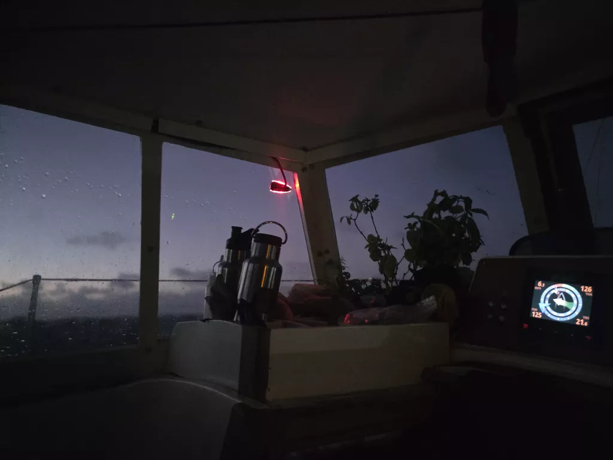

The sporty conditions continued over the night and the day with wind over 32kn at times, and only a slight reduction to sea state while we were at the lee of the Ha'apai Group.

Big seas, quite often splashing the cockpit or breaking against the windscreen of our hard dodger. But also beautiful starry sky,  and blue skies during the day.

We're still working on our sea legs but progress towards Minerva is good. Conditions are supposed to start easing tonight.

* Distance today: 139NM
* Lunch: sandwiches
* Engine hours: 0
