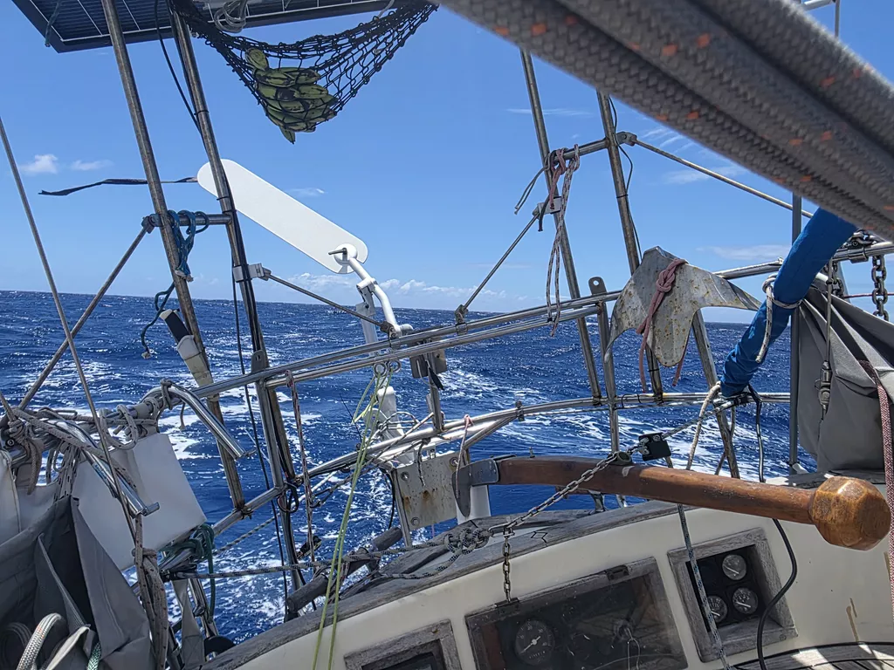

The night was uneventful. Lille Ø kept sailing on its course with little to no intervention from the crew, who were slowly getting fitter from the various levels of sea sickness. The morning grew gray as scattered rainclouds kept swiching the wind between 7 and 27kn. Afternoon brought the sun out and steady winds around 20kn. In the horizon we see the also heavily reefed *Mathilda* flying past us at around 10kn of speed.

Fiji Met Office bulletin promised rough seas north of 22°S, and indeed close to that line things got more comfortable

* Distance today: 132NM
* Lunch: gazpacho
* Engine hours: 0
