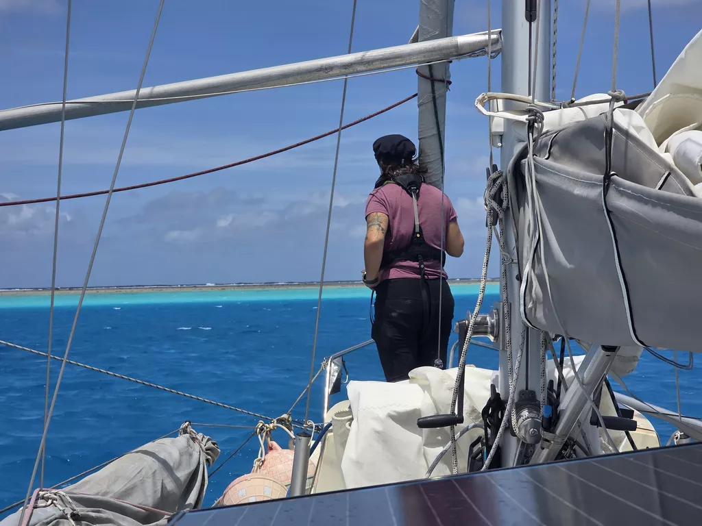

The going got progressively easier the further south we got. In the early hours we had some rain showers that turned the wind, and so in the morning we set up the poled out genoa and shook to first reef. Soon after we crossed the Tropic of Capricorn. Lille Ø is out of the tropics for the first time since leaving Canaries.

Around noon we saw a forest of masts rising up from the horizon. Minerva Reef is a convenient stop along the way to New Zealand, a lot of this weather window's departure cohort has chosen to stop here.

This place is quite amazing, a barren reef atoll in the middle of the ocean. You can see some coral above the surface, but there are no islands like in Tuamotus. We dropped the hook in 10m and are anchored in crystal clear water.

* Distance today: 122NM
* Lunch: spaghetti bolognese
* Engine hours: 1
