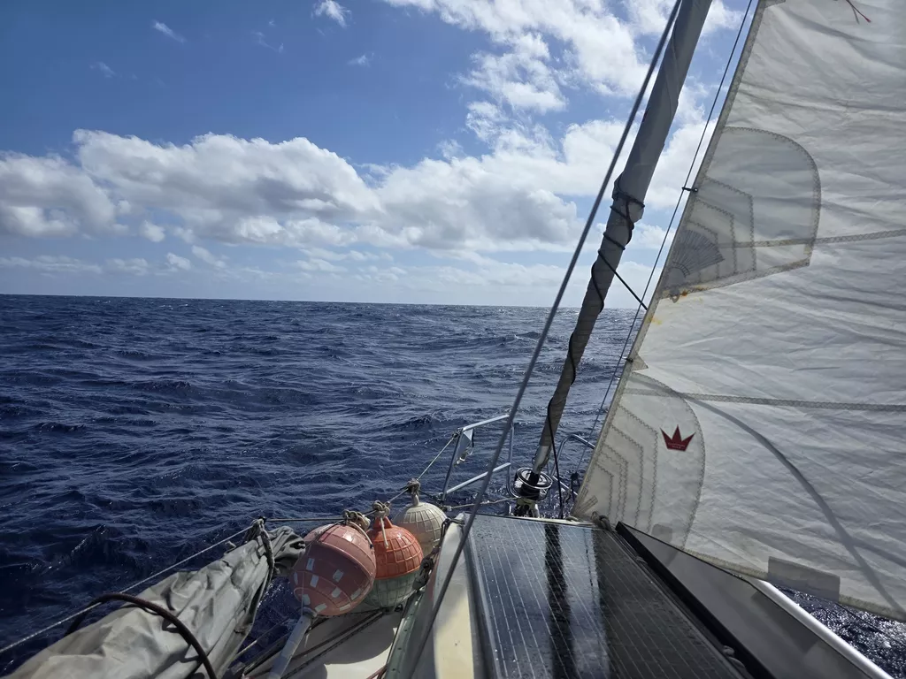

In the morning we woke up to a gloomy grey day. The front had passed us and the wind had turned to be favorable, so we hoisted anchor and left. Inside the atoll we packed the anchor away and set up main in first reef and prepared the staysail on deck. Then it was time to head out of the pass and leave North Minerva Reef behind.

Our time in Minerva was magical. With full moon and practically no wind for few days we could enjoy exploring the reef at low tide and participate to the various social gatherings that were organized. On our last evening the kids were zooming around on dinghies trick and treating. The boats who wanted to participate hoisted the Q-flag to signal that some sweets were available on board. 

As we sailed SW the sky cleared and we embraced the warmth of the sun and calm seas. Over the day as the wind and seas picked up, we put in the second reef and are now comfortable snacking our way towards New Zealand.

* Distance today: 51NM
* Lunch: chili sin carne
* Engine hours: 0.7
