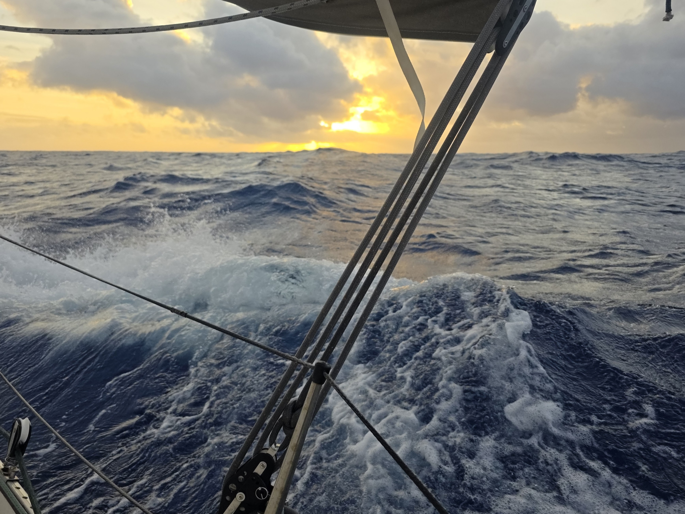

In the night, the winds kept stable and wind wane kept us on course without interventions. As the sun came out, the wind kicked up a notch and kept changing between 20 and 35kn. We needed to keep adjusting the wind vane to match the wind. Around noon we had the biggest gust of 39kn and the waves were steep as we found ourselves in the middle of a counter current. Here the currents are more or less random, so picking a favourable stream is not an option.

With the steep waves we adjusted the course to be a bit more westerly to maximise comfort. As of writing, the waves have started easing along with the wind.

* Distance today: 152NM
* Lunch: coconut lentil soup
* Engine hours: 0
