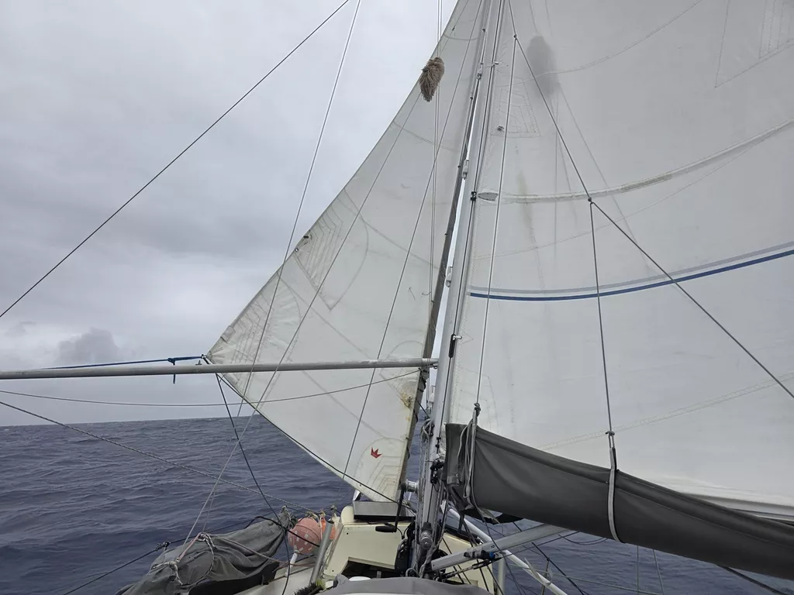

The morning dawned grey and wet. However, also with a significant decrease in sea state. With the wind backing, we were able to pole out the headsail and continue wing on wing.

Despite the murky weather, there was enough sun peeking from behind the clouds that we're finishing the day with full batteries. And we still haven't used the hydrogenerator on this trip. Benefits of a route where the sun is constantly behind us.

The waves are now 1m smaller than yesterday. We're still sailing deeply reefed, as the warm front to the west of us might bring squalls.

* Distance today: 150NM
* Lunch: spaghetti aglio e olio
* Engine hours: 0
