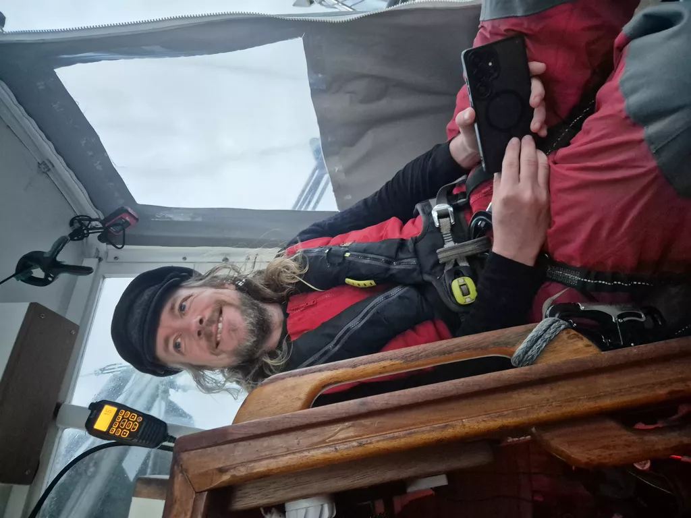

The night gave us yet another challenge: two hours of sustained 40kn winds. We took the main down and kept the staysail. In the pitch black darkness we surfed down the waves with wind howling in our ears. Wearing full set of foulies was not an exaggerated approach to the situation. After that, the winds subseded and we were left with mere 30 knots, what at that point felt calm and easy. 

As the morning rose, we pulled up the main in second reef and opted for good sleep for the off watch instead of speed. The day became a slog forward with deep snoring heard from the sea bunk. 

The air temperature is only 18 degrees, and we are yet again in latitudes where wearing long pants and shirt for the day is not only an option, but a necessity!

* Distance today: 117NM
* Lunch: navy bean soup
* Engine hours: 0
