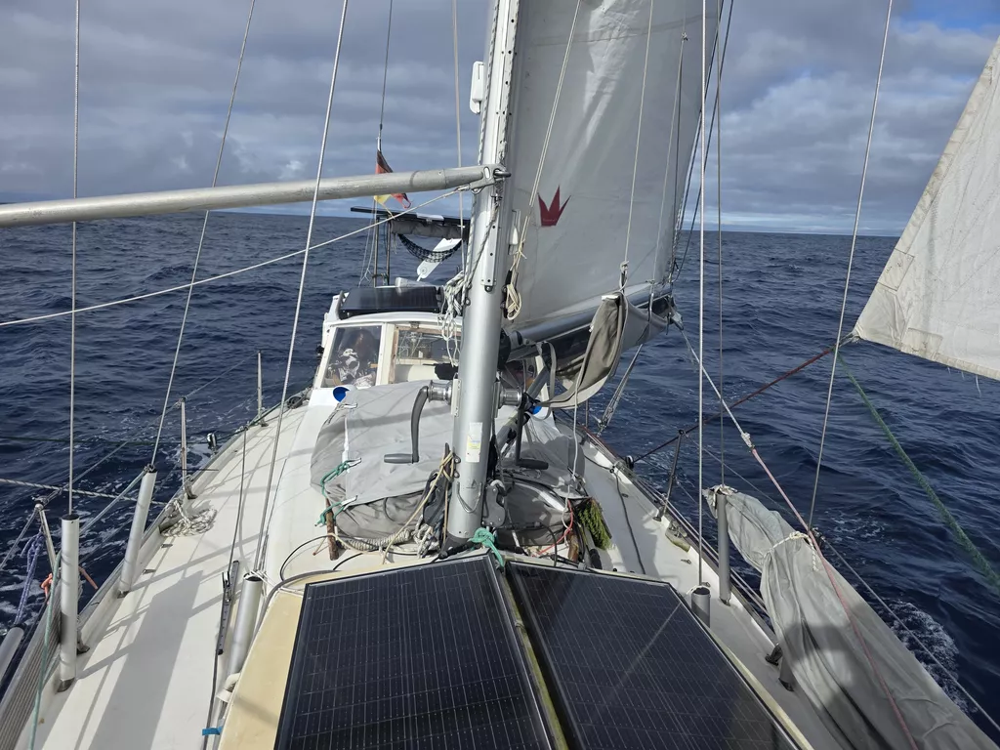

The night was dark and foggy, with visibility only a few meters outside the boat. But winds were light and going quite comfortable.

Easy conditions have continued throughout the day. Wind shifted more to the west, allowing us to unfurl the full genoa on a beam reach. Going is slow but pleasant. Just before noon even the sun came out, allowing batteries to be replenished and some wet gear dried out.

Since tomorrow we'll likely sight New Zealand, we enjoyed a proper freshwater shower.

* Distance today: 101NM
* Lunch: lentil soup
* Engine hours: 0
