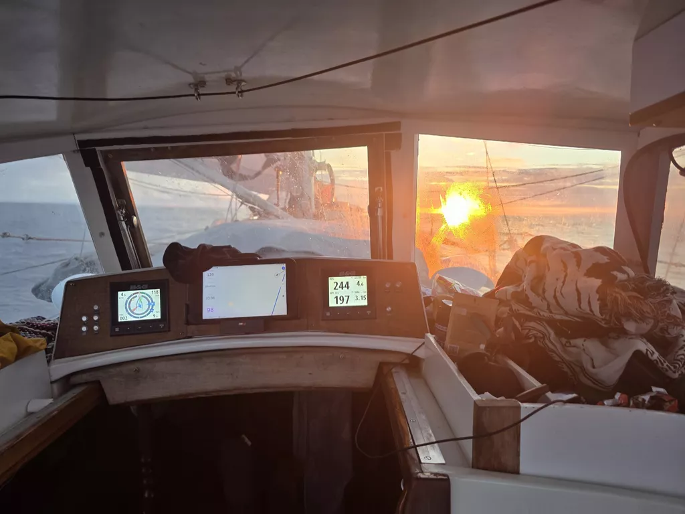

In the night we made it to double digits. We kept changing between broad reach and wing-on-wing depending on where the wind was coming. Morning brought no difference to the sail setup. Nature on the other hand was giving it all. Henri saw a fin of a orca and an albatross!

Later in the afternoon, Suski heard thunder rolling in the distance. It was time to put modern technology to good use as we once more are in the reach of a weather radar. So internet got turned on, location of the thunder identified and sails reduced to second reef and stay sail. This would have been the action taken anyway, but more datapoints is better! 

While waiting for the thunder and rain to approach, Suski saw a pod of dolphins and an albatross. They truly are magnificient and big birds!

* Distance today: 103NM
* Lunch: tomato pasta
* Engine hours: 0
