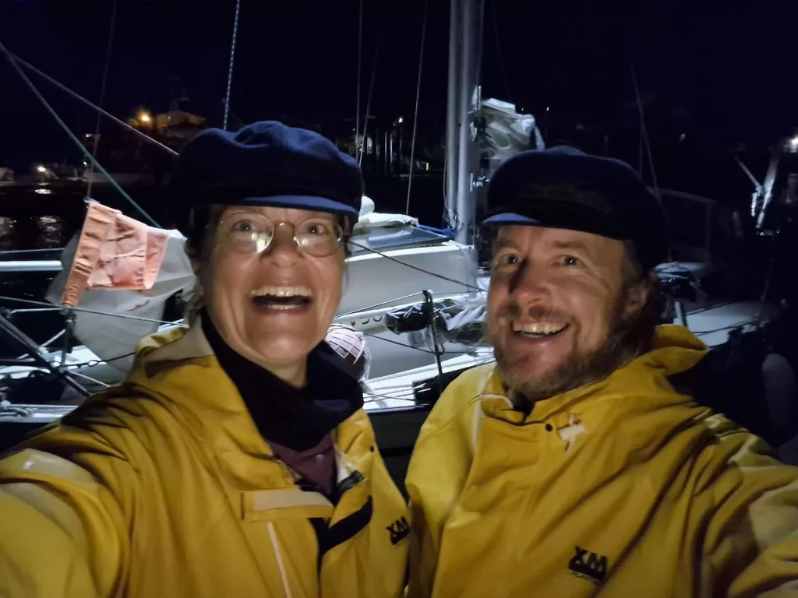

After dinner we watched the darkening skies with wary eyes. Two occluded fronts were due to pass us, bringing buckets of rain and thunder.

Somehow the first one missed us, and there'd be a few hours before the second one, maybe enough to reach harbour? Once we got to the lee of New Zealand, we dropped sail and started the engine.

Navigating into an unknown port in the dark is always interesting. The channel to Opua is well lit with lateral marks and sector lights, but it was still useful to have two pairs of eyes on deck interpreting it all. We managed to reach the quarantine dock before the second row of thunderstorms. New Zealand, we made it!

* Distance today: 34NM
* Engine hours: 2.3
