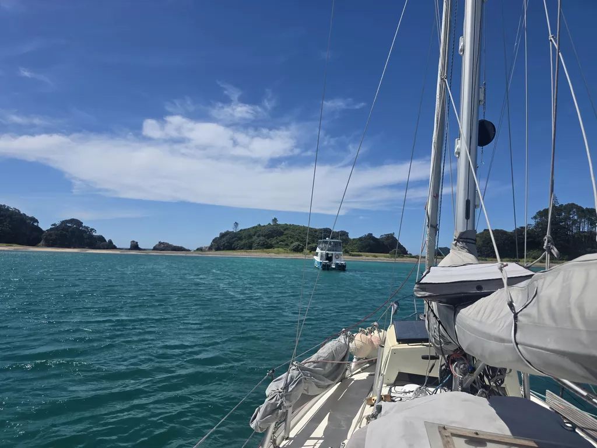

After fun time at the Opua Seafarers Festival, it was again time to move. We filled up the water tank and motored out of the Bay of Islands Marina.

Nice sunny weather awaited us on the bay. Waves were a bit splashy, but not too bad for motoring upwind along the fairway.

We're now anchored in front of the same sandy beach where Captain Cook arrived back in the 18th Century.

* Distance today: 8NM
* Lunch: sandwiches
* Engine hours: 2
