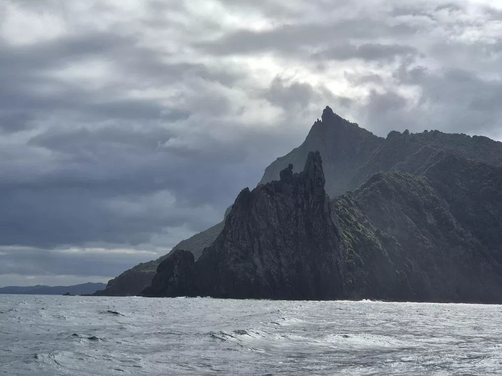
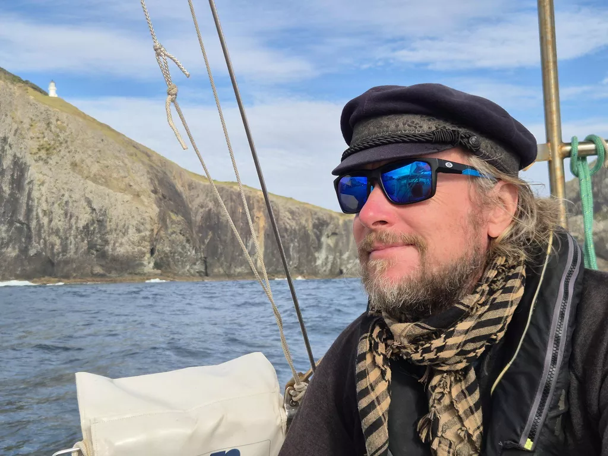

Today we had a long day hop to go, and so we hoisted anchor at dawn. Tomorrow winds will turn southerly, and will remain so for a week. Shame, this coastline would've been nice to sail in smaller hops between the various scenic coves.

In the windless morning we motored towards the Cape Brett lighthouse. After turning the corner there, wind picked up and we were able to start sailing.

What followed was a quite pleasurable sail down the coast. Wing on wing, with a gentle 1.5m swell from the back.

Now we're tucked away in the Marsden Cove Marina, waiting for tomorrow's frontal pass. Dolphins escorted us into the bay.

* Distance today: 64NM
* Lunch: sandwiches 
* Engine hours: 4.7
