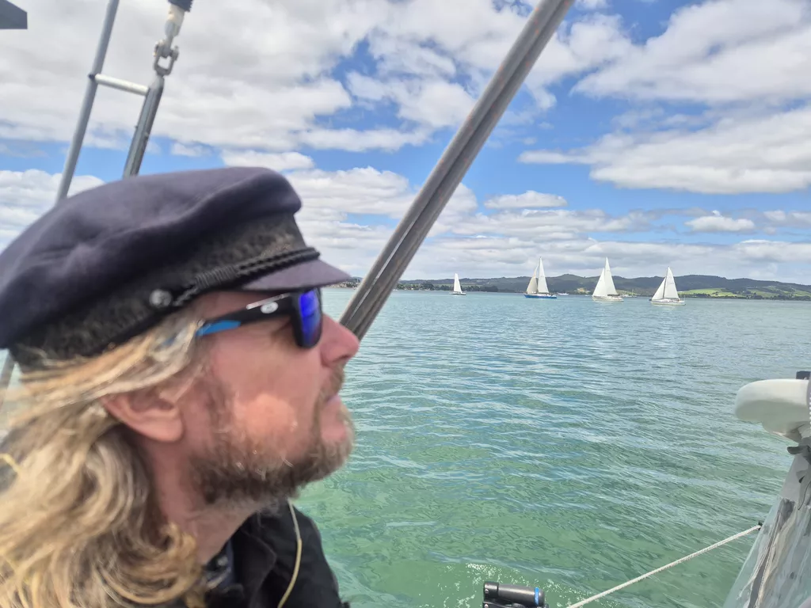

In the still morning, we took down the genoa and folded it properly to await it's meeting with a sailmaker. The UV rays of the sun have eaten away so many threads and the sun protection strip is falling apart in all corners. 

At 11 with low slack we turned on the engine and headed out. We motored the 11 miles up the river with the rising tide aiding our journey. The views are amazing, and if we still had the sails ready and one were not a weary sailor recovering from a cold it would have been a nice sail-like-in-Havel kind of a day. But we were motoring, dodging the oncoming sailing boats. 

In the end the river narrowed down substantially and we motored past multiple marinas and dockyards untill we found our little marina, Okara. We swooped into our box like pros and tied us to the pier. Here we wait untill our haul out time at Riverside Drive marina.

* Distance today: 11NM
* Lunch: vegetable wraps
* Engine hours: 2.4
