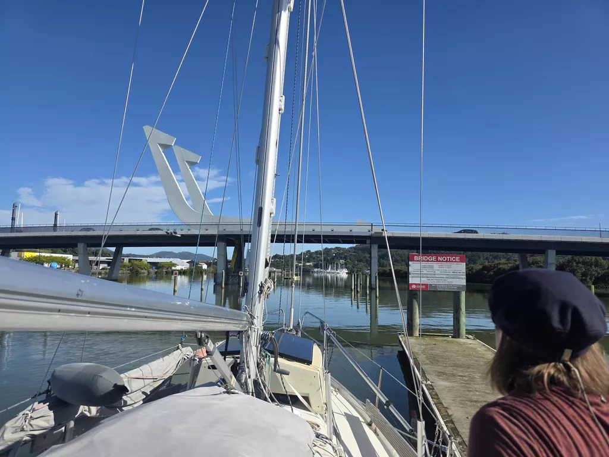
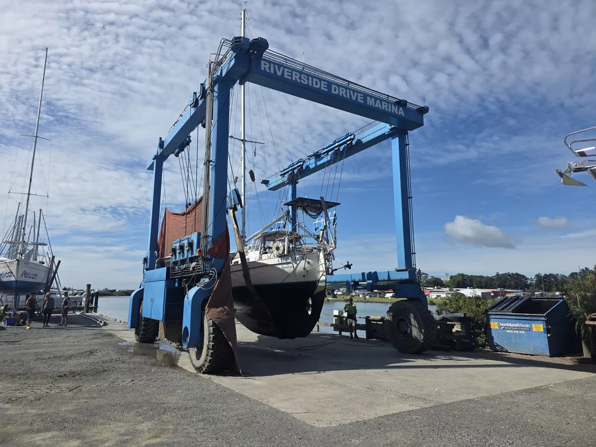

Today's trip was to be both short, and the last one of the season. We called Whangarei Bridge Control over VHF while still in our marina berth, and requested a bridge opening at 9am. Then we slipped the lines and motored to the bridge waiting pier.

The bridge opened as scheduled. We let an outgoing sailboat go through first, and then motored straight to Riverside Drive Marina's haulout berth.

Soon the boat was up on the slings, and after some fiddling we're level and in the parking position where we'll remain for a while. Now starts the project season!

* Distance today: 0.4NM
* Lunch: breakfast rolls
* Engine hours: 0.5
